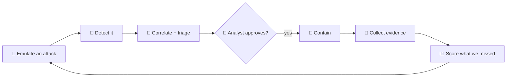

<div align="center">


<a href="https://github.com/blackdalc7"></a>

<p>


</p>


</div>

---

## 👋 Hey, I'm Alvin

I'm a 20-year-old cyber security student from **Kerala, India**, now studying at **Monash University**. I got hooked on computers as a kid and started poking at security when I was **12**: taking apart how things work, breaking them in my own lab, and then figuring out how someone would have caught me.

That's still how I learn. I think like an attacker so I can build like a defender, and most of what's on this profile is me doing exactly that: attacking my own lab, writing the detections that should have fired, and automating the response.

> *"Every alert I write starts with an attack I ran first."*

---

## 🎮 Pick a side

Click to open each one.

<details>
<summary><b>🔴 Red team: how I break things</b></summary>
<br/>

- 🧨 Adversary emulation with **Atomic Red Team**, mapped to **MITRE ATT&CK**, only ever inside my isolated lab
- 🕸️ Attack-path thinking: which single fix cuts off the most of the network? (see my blast-radius scanner)
- 🔎 Recon and enumeration with **Nmap**, then turning raw scan data into a ranked list of what actually matters
- 🧪 Scoring my own attacks: detected, prevented, telemetry only, or missed

</details>

<details>
<summary><b>🔵 Blue team: how I catch things</b></summary>
<br/>

- 📡 Real-time SIEM pipelines: syslog in, ECS / OCSF out, streaming detections for brute force and password spraying
- 📜 **Sigma** rules compiled to SQL and run over a Parquet + DuckDB data lake
- 🖥️ Windows EDR from kernel **ETW**: live process trees, Office-spawns-shell, canary files as ransomware tripwires
- 🤝 SOAR with a human in the loop: no host gets isolated until an analyst clicks *Approve*
- 🧾 DFIR: Velociraptor + Hayabusa into one hashed evidence timeline

</details>

<details>
<summary><b>🟣 Purple team: where the two meet</b></summary>
<br/>



That loop is my whole portfolio, built end to end in [Cyber-personal-portfolio](https://github.com/blackdalc7/Cyber-personal-portfolio).

</details>

---

## 🚀 Featured work

<table>
<tr>
<td width="50%" valign="top">

### 🛰️ [Cyber-personal-portfolio](https://github.com/blackdalc7/Cyber-personal-portfolio)

Ten security tools joined into one loop, with **Watchfloor** as the console that ties them together. SIEM, SOAR, EDR, vuln scanning, Sigma coverage, attack emulation, DFIR and an AI analyst.

**[▶ Live replay demo](https://blackdalc7.github.io/Cyber-personal-portfolio/)**

`Python` `PowerShell` `C#` `React` `DuckDB` `Docker`

</td>
<td width="50%" valign="top">

### 🔍 [DriftWatch-Project](https://github.com/blackdalc7/DriftWatch-Project)

Continuous security validation for a Windows lab. A Go agent runs signed, harmless tests, results get scored against Elastic, and configuration drift is flagged before it becomes a gap.

`Go` `Python` `React` `Elastic` `mTLS`

</td>
</tr>
</table>

<!-- SMALL-PROJECTS:START -->
<!-- SMALL-PROJECTS:END -->

---

## 🧰 My toolkit

<div align="center">

<br/>


<br/>

       

</div>

---

## 🗺️ My journey so far

<details>
<summary><b>Open the timeline</b></summary>
<br/>

| When | What happened |
|---|---|
| 👶 **Kid** | Took apart every computer I was allowed near (and a few I wasn't) |
| 🔐 **Age 12** | First taste of security: how do people get in, and how would you know? |
| 🐧 **Teens** | Linux, scripting, CTF-style puzzles, building and breaking home labs |
| ✈️ **Kerala → Melbourne** | Started Cyber Security at Monash University |
| 🛰️ **Now** | Building a full detection-and-response platform from scratch, one tool at a time |
| 🎯 **Next** | A SOC / threat response role where I get to automate the boring parts |

</details>

---

## 📊 Stats

<div align="center">




</div>

---

## 💬 Ask me about

`detection engineering` · `Sigma rules` · `building home labs` · `Windows internals` · `SOAR automation` · `CTFs` · `why logs are beautiful`

<details>
<summary><b>🥚 Easter egg</b></summary>
<br/>

```bash
$ sudo make me-a-sandwich
[sudo] password for alvin: ********
Detection: T1548 (Abuse Elevation Control Mechanism)
Alert raised. Analyst notified. Sandwich quarantined. 🥪🔒
```

</details>

<div align="center">


**Thanks for stopping by. Stay curious, stay patched.** 🛡️

</div>
