Cyber security student at Monash University, focused on **detection engineering and incident response**. I build detections, run the attacks they are meant to catch in an isolated lab, and write down what fired, what missed and what I changed.

**Looking for:** junior SOC analyst or detection engineering roles and internships.

**Contact:** [LinkedIn](https://www.linkedin.com/in/alvin-thomo/) · [alvin.thomo@gmail.com](mailto:alvin.thomo@gmail.com) · [atho0105@student.monash.edu](mailto:atho0105@student.monash.edu)

## Flagship work

**[Cyber-personal-portfolio](https://github.com/blackdalc7/Cyber-personal-portfolio)**
A detection-and-response loop built from ten small tools: syslog SIEM, Sigma rules over a DuckDB data lake, a SOAR bot that only isolates a host after an analyst approves, Windows ETW process monitoring, attack emulation with Atomic Red Team, and evidence collection with Velociraptor. The README separates what is unit tested, replay tested and live-lab tested.
[Replay demo](https://blackdalc7.github.io/Cyber-personal-portfolio/) · [CI](https://github.com/blackdalc7/Cyber-personal-portfolio/actions/workflows/ci.yml)

**[DriftWatch-Project](https://github.com/blackdalc7/DriftWatch-Project)**
Continuous security validation for a two-VM Windows lab. A Go agent runs only signed, benign tests; the server scores each one against Elastic and flags configuration drift.
[CI](https://github.com/blackdalc7/DriftWatch-Project/actions/workflows/ci.yml)

<!-- CASE-STUDY:START -->
<!-- CASE-STUDY:END -->

<!-- OTHER-PROJECTS (enable once these repos are published)
## Other projects

Smaller builds for practising languages and fundamentals.

| Area | Projects |
|---|---|
| Security and systems | [mini-os](https://github.com/blackdalc7/mini-os) (x86 boot sector and C kernel) · [port-scanner](https://github.com/blackdalc7/port-scanner) (Go) · [file-integrity-monitor](https://github.com/blackdalc7/file-integrity-monitor) (Python) · [logstats](https://github.com/blackdalc7/logstats) (Rust) · [hexdump](https://github.com/blackdalc7/hexdump) (C) · [subnet-calculator](https://github.com/blackdalc7/subnet-calculator) (Python) · [sysadmin-toolkit](https://github.com/blackdalc7/sysadmin-toolkit) (Bash) |
| Data and SQL | [campus-library-sql](https://github.com/blackdalc7/campus-library-sql) (SQLite) · [study-habits-analysis](https://github.com/blackdalc7/study-habits-analysis) (pandas) · [numpy-game-of-life](https://github.com/blackdalc7/numpy-game-of-life) (NumPy) |
| Front end and fun | [keyboard-meteors](https://github.com/blackdalc7/keyboard-meteors) · [pixel-pomodoro](https://github.com/blackdalc7/pixel-pomodoro) · [terminal-dungeon](https://github.com/blackdalc7/terminal-dungeon) · [go-task-tracker](https://github.com/blackdalc7/go-task-tracker) · [rust-maze](https://github.com/blackdalc7/rust-maze) |
-->

## Tools

**Detection and response:** Sigma, MITRE ATT&CK, Elastic, OCSF / ECS, Velociraptor, Hayabusa, Atomic Red Team, Nmap

**Languages:** Python, Go, PowerShell, C, Rust, SQL, TypeScript

**Platforms:** Linux, Windows (Sysmon, ETW), Docker, GitHub Actions

## About me

I grew up in Kerala, India, and have been taking computers apart, and then working out how to defend them, since I was a kid. These days that curiosity goes into my home lab, where I try to understand an attack well enough to write the detection that should catch it.
